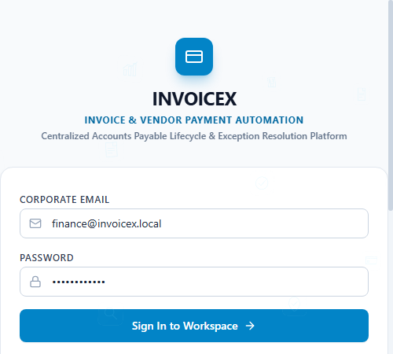
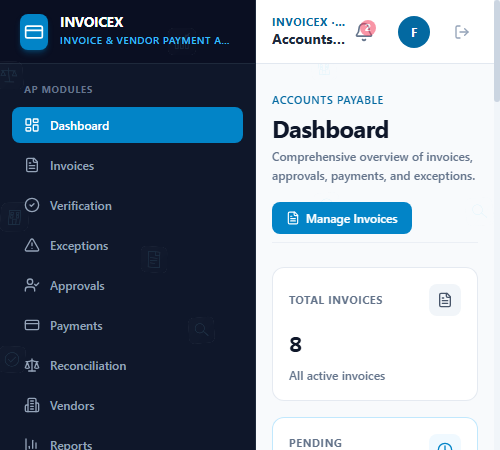
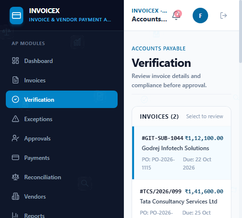
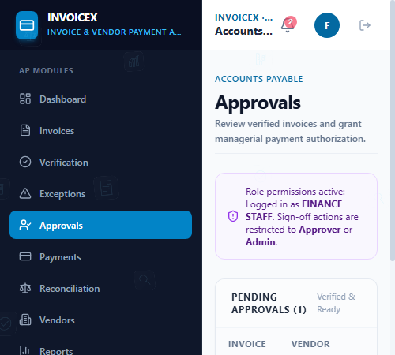
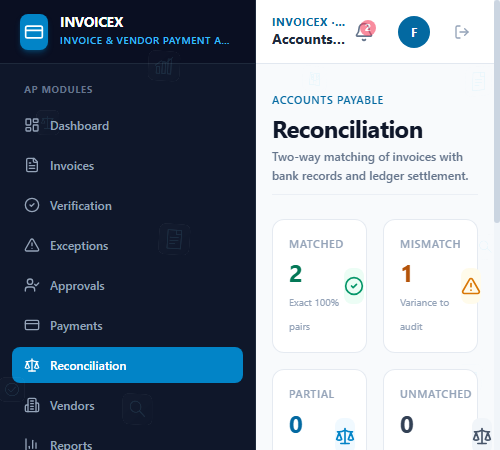

# InvoiceX – Invoice & Vendor Payment Automation Platform

InvoiceX is an enterprise-grade Accounts Payable (AP) and vendor disbursement platform designed to streamline, automate, and reconcile B2B invoice-to-payment operations.

---

## 📌 Problem

Traditional enterprise accounts payable processes suffer from:
- Manual invoice entry and verification bottlenecks
- High risk of duplicate invoice submissions and double disbursements
- Lack of clear segregation of duties between finance staff and releasing authorities
- Untracked communication gaps between exceptions, disputes, and approvals
- Delayed bank reconciliations and lack of an immutable audit trail

---

## 💡 Solution

InvoiceX provides a single, unified system that automates the end-to-end invoice lifecycle. By combining strict verification checks, proactive duplicate detection, segregation of duties via Role-Based Access Control (RBAC), and automated two-way bank reconciliation, InvoiceX prevents payment leakage and accelerates vendor settlement cycles.

---

## 🔄 Core Workflow

```
[ Invoice Ingestion ] 
        ↓
[ Automated Verification ] 
        ↓
[ Duplicate Detection Check ]
        ↓
[ Exception Resolution ] (if discrepancies flagged)
        ↓
[ Multi-Role Approval Workflow ]
        ↓
[ Payment Scheduling & Batch Release ]
        ↓
[ Real-Time Payment Tracking ]
        ↓
[ Two-Way Bank Reconciliation ]
        ↓
[ Financial Reporting & Audit Logging ]
```

---

## 🖼️ Application Screenshots

### 1. Corporate Authentication & Quick Roles


### 2. Financial Operations Dashboard


### 3. Automated Pre-Flight Verification & Duplicate Check


### 4. Segregation of Duties AP Approvals


### 5. Vendor Payment Scheduling & Disbursement Tracking


### 6. Two-Way Bank Statement Reconciliation


---

## ✨ Key Features

- **Automated Pre-Flight Verification:** Multi-point sanity validation evaluating Vendor GSTIN, mathematical sum checks, PO line-item matching, and active vendor standing.
- **Duplicate Prevention Engine:** Automated fuzzy detection scanning for duplicate vendor invoice numbers, duplicate PO billing, and matching payment amounts.
- **Exception Resolution Desk:** Discrepancy quarantine with structured escalation paths: vendor correction request, line-item recalculation, or manual override with audit reasons.
- **Segregation of Duties (SoD) Approvals:** Tiered approval authority preventing finance submitters from approving their own scheduled disbursements.
- **Payment Operations & UTR Tracking:** Multi-mode batch scheduling (NEFT, RTGS, IMPS, ACH) with unique transaction reference (UTR) generation and lifecycle status tracking.
- **Automated Bank Reconciliation:** 2-way matching engine pairing internal payment ledgers against external bank statements, detecting variance anomalies.
- **Immutable Audit Trail:** Chronological tamper-evident logging of every status transition, approval action, and system override.

---

## 👥 User Roles

| Role | Corporate Persona | Operational Scope |
|---|---|---|
| **FINANCE_STAFF** | Finance Specialist | Invoice entry, automated verification, exception handling, payment batch scheduling, bank statement reconciliation. |
| **APPROVER** | AP Approver | Independent claims review, commercial approval/rejection, release authorization, dispute escalation. |
| **ADMIN** | System Administrator | Platform configuration, vendor master directory management, user administration, global compliance audit oversight. |

---

## 🛠️ Technology Stack

- **Frontend:** React 18, Vite, Tailwind CSS, Lucide React, Three.js
- **Backend:** Node.js, Express.js (REST API architecture)
- **Database:** PostgreSQL (with embedded failover engine for zero-setup execution)
- **Authentication:** Stateless JSON Web Tokens (JWT) with bcrypt password hashing
- **HTTP Client:** Axios with centralized interceptors and bearer token authorization

---

## 🏗️ System Architecture

```
┌────────────────────────────────────────────────────────┐
│               Client Tier (React + Vite)               │
│   • Dashboard   • Verification   • Approvals           │
│   • Payments    • Reconciliation • Audit Trail         │
└───────────────────────────┬────────────────────────────┘
                            │ HTTPS / JSON REST APIs
┌───────────────────────────▼────────────────────────────┐
│              Backend Tier (Node.js + Express)          │
│   • JWT Auth & RBAC Middleware                         │
│   • Automated Verification & Duplicate Engine          │
│   • Payment Scheduler & Reconciliation Service         │
│   • Tamper-Evident Audit Logger                        │
└───────────────────────────┬────────────────────────────┘
                            │ Parameterized SQL Queries
┌───────────────────────────▼────────────────────────────┐
│              Data Tier (PostgreSQL Relational DB)      │
│   • 10 Normalized Relational Tables with Foreign Keys  │
└────────────────────────────────────────────────────────┘
```

---

## 🗄️ Database Schema

The database consists of 10 relational tables ensuring data integrity across the AP lifecycle:

1. `users` — Authentication credentials, roles (`ADMIN`, `FINANCE_STAFF`, `APPROVER`), and departmental metadata.
2. `vendors` — Registered vendor profiles, tax identifiers (GSTIN/PAN), MSME categorization, and bank account details.
3. `purchase_orders` — Approved purchase orders with allocated budgets and line-item allocations.
4. `invoices` — Primary invoice records, tax summaries, due dates, and lifecycle statuses (`DRAFT`, `PENDING_VERIFICATION`, `VERIFIED`, `APPROVED`, `PAID`, `RECONCILED`, `EXCEPTION`).
5. `invoice_items` — Detailed line items with HSN/SAC codes, quantities, unit prices, and tax rates.
6. `exceptions` — Quarantined issues, discrepancy types, severity levels, and resolution notes.
7. `approval_history` — Sequential audit logs of review decisions, comments, and approver IDs.
8. `payments` — Scheduled disbursements, payment methods, execution timestamps, and UTR tracking numbers.
9. `reconciliations` — Two-way matching records linking bank settlement logs to internal invoices.
10. `audit_logs` — Immutable system-wide action tracking for regulatory compliance.

---

## 🔒 Security & Compliance

- **Stateless JWT Authentication:** Cryptographically signed tokens with configurable expiration and automatic session expiration handling.
- **Strict Role-Based Access Control (RBAC):** Backend-enforced route guards preventing privilege escalation.
- **SQL Injection Prevention:** 100% parameterized queries across all database operations.
- **Segregation of Duties (SoD):** Built-in financial compliance preventing the same user from submitting and authorizing releases.
- **Comprehensive Audit Trail:** All state mutations log user ID, timestamp, entity references, and previous vs. updated states.

---

## 🚀 How to Run

### Prerequisites
- **Node.js**: v18.0.0 or higher
- **npm**: v9.0.0 or higher
- *(Optional)* PostgreSQL server (an embedded PostgreSQL engine activates automatically if an external instance is not detected).

### 1. Clone & Configure Environment
```bash
git clone https://github.com/your-username/invoicex.git
cd invoicex
cp .env.example .env
```

### 2. Start Backend Server
```bash
cd server
npm install
npm start
```
*Backend runs at `http://localhost:5000`*

### 3. Start Frontend Client
In a new terminal window:
```bash
cd client
npm install
npm run dev
```
*Frontend runs at `http://localhost:5173`*

---

## 🔑 Demo Credentials

| Role | Email | Password |
|---|---|---|
| **Finance Specialist** | `finance@invoicex.local` | `Password@123` |
| **AP Approver** | `manager@invoicex.local` | `Password@123` |
| **System Administrator** | `admin@invoicex.local` | `Password@123` |

*(Quick-switch persona buttons are also available on the login page for rapid workflow testing).*

---

## 🔮 Future Enhancements

- **Intelligent OCR & Document Parsing:** Native PDF and scanned receipt ingestion using layout-aware computer vision models.
- **Direct Banking & Gateway Integration:** Direct host-to-host Open Banking APIs (e.g., ICICI/HDFC Corporate Banking, RazorpayX) for automated straight-through processing (STP).
- **Advanced Predictive AI/ML:** Anomaly detection algorithms for early fraud risk scoring, vendor spend forecasting, and cash-discount optimization.