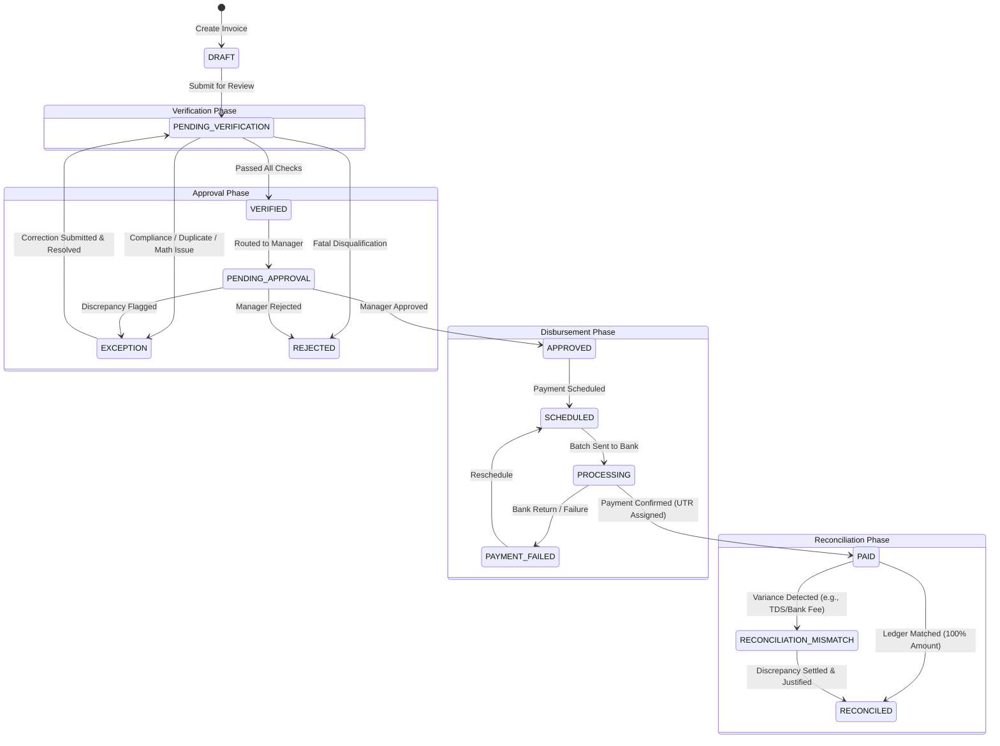
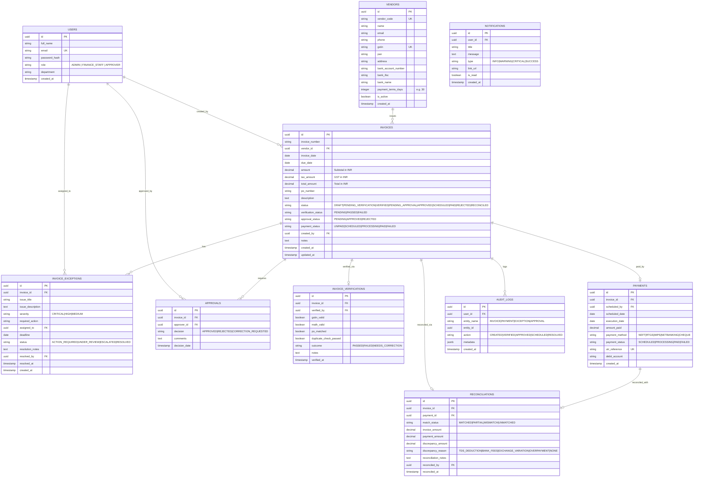

# INVOICE & VENDOR PAYMENT AUTOMATION PLATFORM
## System Architecture, Design Blueprint & Implementation Plan

---

## 1. Final Feature List

### Core Workflow Modules
1. **Invoice Management**
   - Centralized searchable & filterable repository of all vendor invoices.
   - Comprehensive invoice attributes: Invoice ID, Number, Vendor, PO Number, Invoice Date, Due Date, Subtotal, Tax Amount (GST 18%), Total Amount (INR ₹), Statuses, Line Item Description, Notes.
   - Manual Creation Modal & Mock Invoice File Upload with instant field extraction.
   - Status indicators across 3 dimensions: Lifecycle Status, Verification Status, Approval Status, Payment Status.
   - Advanced filtering (by Vendor, Date Range, Status, Due Date urgency) and multi-column sorting.

2. **Automated & Rule-Based Invoice Verification**
   - Rule checks on creation/verification:
     - Mandatory field completeness (Invoice Number, Dates, PO Number, Amounts).
     - Vendor tax compliance verification (GSTIN format validation).
     - Mathematical consistency check (`Total Amount == Amount + Tax`).
     - Past due-date detection.
   - Actionable verification controls: Verify, Reject with Reason, Request Correction, Add Verification Note.
   - Transparent error breakdowns (e.g., *"Vendor GSTIN 27ABCDE1234F1Z5 is invalid or missing"*, *"PO Number PO-2024-889 has no matched contract"*).

3. **Deterministic Duplicate Detection Engine**
   - Business rule check: Detects existing active invoices matching:
     - Same Vendor ID + Same Invoice Number
     - Same Vendor ID + Same Total Amount + Issue date within 30 days
   - Non-blocking warning banners linking directly to the duplicate candidate invoice with side-by-side comparison.

4. **⭐ Differentiating Feature: Exception & Resolution Center**
   - The central operational hub for Accounts Payable blockers.
   - Structured 5-point diagnosis for every exception:
     - **WHAT** went wrong? (Detailed issue statement & rule triggered)
     - **WHO** needs to act? (Assigned Owner: Finance Staff / Approver / Vendor Liaison)
     - **WHAT** action is required? (Clear resolution steps, e.g., "Contact vendor for revised tax invoice")
     - **WHEN** should it be resolved? (Resolution SLA deadline + overdue countdown)
     - **WHAT** is the current status? (`ACTION_REQUIRED`, `UNDER_REVIEW`, `ESCALATED`, `RESOLVED`)
   - Severity classification: `CRITICAL` (Immediate payment stop / fraud risk), `HIGH` (Tax/Amount discrepancy), `MEDIUM` (Missing PO / documentation).
   - Operational actions: Assign to user, Update resolution notes, Mark Resolved (with resolution summary), Reopen exception with justification, Link to Invoice Details.

5. **Approval Workflow Center**
   - Segregation of Duties: Approver/Manager role reviews verified invoices.
   - Multi-tiered context view: PO comparison, verification report, line items, and active/resolved exception history.
   - Actions: One-click Approve, Reject with mandatory comment, or Send Back for Correction.
   - Audit trail stamping for every approval decision.

6. **Payment Scheduling & Cash Flow Management**
   - List of approved, payable invoices with due date indicators (Overdue, Due Today, Due in 7 Days, Due in 30 Days).
   - Scheduler modal: Payment Method selection (NEFT, RTGS, IMPS, Corporate NetBanking, Cheque), Target Execution Date, Source Bank Account selection.
   - Payment status progression: `NOT_SCHEDULED` → `SCHEDULED` → `PROCESSING` → `PAID` → `FAILED`.

7. **Payment Tracking & Execution History**
   - Visual step-by-step payment timeline: Invoice Approved → Scheduled → Sent to Bank → Processed/UTN Generated.
   - Reference Number / UTR (Unique Transaction Reference) tracking.
   - Payment receipt generation and proof view.

8. **Two-Way Reconciliation Module**
   - Matching Invoice records against Bank/Disbursement ledger entries.
   - Match categories:
     - **Fully Matched**: Invoice total == Payment amount & UTR confirmed.
     - **Partially Matched**: Partial disbursement made against invoice.
     - **Amount Mismatch**: Variance flagged (e.g., Invoice ₹50,000 vs Paid ₹48,000 → ₹2,000 difference flagged with reason, e.g., TDS 2% deduction or bank charge).
     - **Unmatched**: Payment executed without verified invoice or invoice marked paid without bank entry.
   - Manual reconciliation override with mandatory auditor remarks.

9. **Finance Analytics & Reporting**
   - KPI metrics: Days Payable Outstanding (DPO estimate), Cash outflow forecast, Exception aging, Vendor spend distribution.
   - Visual breakdowns: Status distributions, Monthly spend trajectory, Top 5 vendors by volume.
   - Export-ready data tables (CSV/JSON).

10. **State-Driven Notification System**
    - Notification triggers tied directly to lifecycle events (New invoice pending verification, Exception assigned to you, Approval SLA exceeded, Payment due in 24 hours).
    - Unread counters, mark-as-read, and direct deep-linking to target invoice or exception.

11. **System Audit Logs & Activity Feed**
    - Immutable ledger of all lifecycle actions (User, Action, Entity, Timestamp, Diff summary).

---

## 2. Page List & Routing Hierarchy

| Route | Page Name | Access Roles | Primary Purpose |
|---|---|---|---|
| `/login` | Authentication / Login | Public | User credentials entry, demo quick-fill role switcher |
| `/dashboard` | Executive AP Dashboard | All Roles | "What needs my attention today?", KPI stats, Action Required queue |
| `/invoices` | Invoice Management | All Roles | List, search, filter, and initiate invoice creation/upload |
| `/invoices/:id` | Invoice Details & Audit View | All Roles | 360° invoice dossier: vendor info, line items, timeline, attachments |
| `/verification` | Invoice Verification Queue | Finance Staff, Admin | Side-by-side compliance checks, validation checklist, verification actions |
| `/exceptions` | Exception & Resolution Center | All Roles (Action by Staff/Admin) | The triage center for blockers; assign, update SLA, resolve |
| `/approvals` | Approval Center | Approver/Manager, Admin | Dedicated manager queue to review verified invoices and record sign-off |
| `/payments/schedule` | Payment Scheduling | Finance Staff, Admin | Calendar & table of approved invoices; schedule disbursement date & mode |
| `/payments/track` | Payment Tracking | All Roles | Live disbursement statuses, UTR references, payment timeline |
| `/reconciliation` | Bank & Ledger Reconciliation | Finance Staff, Admin | Invoice ↔ Payment ledger matching, mismatch discrepancy resolution |
| `/vendors` | Vendor Directory | Finance Staff, Admin | Vendor master data, GSTIN, MSME status, payment terms, contact details |
| `/reports` | AP Reports & Analytics | Admin, Manager, Finance Staff | Summary metrics, vendor spend charts, exception analytics, CSV export |
| `/notifications` | Notification Center | All Roles | Notification feed with direct deep-links |
| `/settings` | System Settings & Profile | All Roles | Current user profile, role permissions reference, system audit logs |

---

## 3. User Roles & Permission Matrix

```
Legend: [C] Create, [R] Read, [U] Update, [D] Delete, [A] Approve/Action
```

| Feature / Domain | ADMIN | FINANCE STAFF | APPROVER / MANAGER |
|---|---|---|---|
| User Management & System Logs | C, R, U, D | R (Profile only) | R (Profile only) |
| Vendor Directory | C, R, U, D | C, R, U | R |
| Invoices (Create / Edit Draft) | C, R, U, D | C, R, U | R |
| Invoice Verification | R, A | C, R, U, A | R |
| Exception Center (Triage & Resolve) | R, U, A | C, R, U, A | R, U (Add comments) |
| Approval Center (Approve / Reject) | R, A (Admin override) | R (View status) | R, A (Primary Approver) |
| Payment Scheduling & Tracking | C, R, U, A | C, R, U, A | R |
| Bank Reconciliation | C, R, U, A | C, R, U, A | R |
| Executive Reports & Analytics | Full Access | Operational Reports | Executive Reports |

---

## 4. Complete Invoice Lifecycle State Machine



---

## 5. Relational Database Schema Plan (PostgreSQL)



---

## 6. Backend API Plan (RESTful Express.js)

### Authentication & Users
- `POST /api/auth/login` → Authenticate user, return JWT and profile with permissions.
- `GET  /api/auth/me` → Verify session, return active user.
- `GET  /api/users` → List AP team members (for assigning exceptions/approvals).

### Vendors
- `GET    /api/vendors` → List vendors with search and filters.
- `POST   /api/vendors` → Add new vendor master record with GSTIN/bank details.
- `GET    /api/vendors/:id` → Vendor profile, payment history, open invoices.
- `PUT    /api/vendors/:id` → Update vendor information.

### Invoices
- `GET    /api/invoices` → Paginated list with filters (`status`, `vendorId`, `search`, `dueFilter`).
- `POST   /api/invoices` → Create invoice (triggers automatic duplicate check & validation rules).
- `GET    /api/invoices/:id` → Complete invoice dossier (line items, verification, exceptions, approvals, payment, audit log).
- `PUT    /api/invoices/:id` → Update invoice (if still in editable status).
- `DELETE /api/invoices/:id` → Soft delete or archive draft invoice.
- `POST   /api/invoices/check-duplicate` → Real-time pre-submission duplicate check.

### Verification Engine
- `POST   /api/invoices/:id/verify` → Execute manual/rule verification, update status to `VERIFIED` or generate exceptions.
- `POST   /api/invoices/:id/reject-verification` → Reject invoice with specific compliance justification.

### Exception & Resolution Center
- `GET    /api/exceptions` → List all exceptions (filterable by `status`, `severity`, `assignedTo`).
- `GET    /api/exceptions/:id` → Detailed exception diagnosis & action history.
- `POST   /api/exceptions/:id/assign` → Reassign exception to specific user.
- `PUT    /api/exceptions/:id/status` → Update status (`ACTION_REQUIRED`, `UNDER_REVIEW`, `ESCALATED`).
- `POST   /api/exceptions/:id/resolve` → Submit resolution note, mark resolved, re-evaluate invoice status.

### Approval Center
- `GET    /api/approvals/pending` → Invoices awaiting manager decision.
- `POST   /api/approvals/:id/approve` → Manager approval sign-off.
- `POST   /api/approvals/:id/reject` → Manager rejection with mandatory comment.
- `POST   /api/approvals/:id/request-correction` → Sends back to Finance Staff with note.

### Payments
- `GET    /api/payments` → List payment records with status and UTRs.
- `POST   /api/payments/schedule` → Schedule payment date, method, debit account.
- `POST   /api/payments/:id/process` → Simulate bank batch execution (moves to PROCESSING → PAID with UTR).
- `GET    /api/payments/tracking` → Payment status timeline and upcoming cash requirements.

### Reconciliation
- `GET    /api/reconciliation` → List reconciliation pairs, match rates, discrepancies.
- `POST   /api/reconciliation/match` → Confirm 1-to-1 match or settle discrepancy with justification note.

### Dashboard & Reports
- `GET    /api/dashboard/stats` → Executive KPIs, urgent Action Required list, timeline feeds.
- `GET    /api/reports/summary` → Aggregate AP spend, aging buckets, vendor volume, exception resolution metrics.

### Notifications
- `GET    /api/notifications` → User notifications with unread count.
- `PUT    /api/notifications/:id/read` → Mark notification as read.
- `PUT    /api/notifications/read-all` → Mark all as read.

---

## 7. Frontend Folder Structure (React + Vite + Tailwind CSS)

```
client/
├── index.html
├── package.json
├── vite.config.js
├── tailwind.config.js
├── postcss.config.js
└── src/
    ├── main.jsx
    ├── App.jsx
    ├── index.css
    ├── api/
    │   ├── axiosClient.js          // Axios instance with JWT interceptor & error handling
    │   ├── authApi.js
    │   ├── invoiceApi.js
    │   ├── exceptionApi.js
    │   ├── approvalApi.js
    │   ├── paymentApi.js
    │   ├── reconciliationApi.js
    │   └── vendorApi.js
    ├── context/
    │   ├── AuthContext.jsx         // User session, roles, quick demo switcher
    │   └── NotificationContext.jsx // Toast alerts and unread notification counter
    ├── components/
    │   ├── common/
    │   │   ├── Button.jsx
    │   │   ├── Badge.jsx           // Color-coded status badges (Verified, Critical, Paid)
    │   │   ├── Modal.jsx
    │   │   ├── Table.jsx           // Reusable sorting/paginated table
    │   │   ├── StatCard.jsx        // Metric cards with trend indicators
    │   │   ├── Breadcrumb.jsx
    │   │   ├── EmptyState.jsx
    │   │   ├── LoadingSkeleton.jsx
    │   │   └── ConfirmDialog.jsx
    │   ├── layout/
    │   │   ├── AppLayout.jsx       // Main shell with sidebar + header
    │   │   ├── Sidebar.jsx         // Role-aware navigation links
    │   │   ├── Header.jsx          // Global search, notifications, demo role switcher
    │   │   └── QuickRoleBar.jsx    // Top banner for easy 1-click role switching during college demo!
    │   ├── invoice/
    │   │   ├── InvoiceStatusBadge.jsx
    │   │   ├── InvoiceFormModal.jsx
    │   │   └── DuplicateWarningBanner.jsx
    │   ├── exception/
    │   │   ├── ExceptionCard.jsx   // Displays 5-point diagnosis clearly
    │   │   ├── ExceptionFilter.jsx
    │   │   └── ResolveModal.jsx
    │   └── payment/
    │       ├── PaymentTimeline.jsx
    │       └── SchedulePaymentModal.jsx
    ├── pages/
    │   ├── LoginPage.jsx
    │   ├── DashboardPage.jsx
    │   ├── InvoiceListPage.jsx
    │   ├── InvoiceDetailPage.jsx
    │   ├── VerificationPage.jsx
    │   ├── ExceptionCenterPage.jsx
    │   ├── ApprovalCenterPage.jsx
    │   ├── PaymentSchedulingPage.jsx
    │   ├── PaymentTrackingPage.jsx
    │   ├── ReconciliationPage.jsx
    │   ├── VendorManagementPage.jsx
    │   ├── ReportsPage.jsx
    │   └── SettingsPage.jsx
    └── utils/
        ├── currency.js             // Indian Rupee formatting (e.g. ₹1,25,000.00)
        ├── date.js                 // Relative and standard date formatting
        └── validators.js           // GSTIN, IFSC, Amount validation rules
```

---

## 8. UI/UX Design System Specification

### Color Palette (Professional B2B Financial SaaS)
- **Primary Canvas / Background**: `#F8FAFC` (Slate-50) – crisp, clean, glare-free.
- **Card & Surface Background**: `#FFFFFF` (Pure White) with subtle `#E2E8F0` border.
- **Primary Brand / Action Accent**: `#0284C7` (Sky-600) & `#0369A1` (Sky-700) – confident, institutional finance aesthetic.
- **Dark Neutral (Headings & Primary Text)**: `#0F172A` (Slate-900) – high contrast readability.
- **Secondary Neutral (Labels & Subtext)**: `#475569` (Slate-600) and `#64748B` (Slate-500).
- **Functional Semantic Accents**:
  - **Success (Verified / Approved / Reconciled / Paid)**: `#10B981` (Emerald-500) / Background `#ECFDF5`.
  - **Warning / Action Required (Pending / Medium Exception / Partial)**: `#F59E0B` (Amber-500) / Background `#FFFBEB`.
  - **Critical / Danger (Rejected / Failed / Critical Exception)**: `#EF4444` (Rose-500) / Background `#FEF2F2`.
  - **Informational / Scheduled**: `#6366F1` (Indigo-500) / Background `#EEF2FF`.

### Typography & Spacing
- Font Family: Clean modern sans-serif (`Inter`, `system-ui`).
- Visual Hierarchy:
  - Page Titles: `text-2xl font-bold tracking-tight text-slate-900`
  - Section Headers: `text-lg font-semibold text-slate-800`
  - Metric Values: `text-2xl font-bold font-mono text-slate-900`
  - Body Text: `text-sm text-slate-700`
  - Captions/Timestamps: `text-xs text-slate-500`

### Interactive Polish
- Status Badges: Pill-shaped with subtle border and dot indicator (`bg-emerald-50 text-emerald-700 border-emerald-200`).
- Tables: Sticky header, hover state row highlight (`hover:bg-slate-50/80`), row clickability for detail view.
- Demo Ease-of-Use: A **Demo Role Switcher** prominently positioned in the top header so the reviewer can effortlessly toggle between **Finance Staff**, **Approver/Manager**, and **Admin** in 1 click without re-logging!

---

## 9. Implementation Phases

1. **Phase 1: Foundation & PostgreSQL Data Layer**
   - Database schema DDL, migration files, seed script with realistic Indian vendors, invoices, and exceptions.
   - Dual-mode database adapter (connects to PostgreSQL via `pg`, with a local zero-setup fallback so the demo never fails on any machine).

2. **Phase 2: Express Backend Core, Auth & Middleware**
   - Server bootstrap, JWT authentication, role guards, and standardized JSON error handlers.

3. **Phase 3: React Frontend Scaffold & Design System**
   - Vite + Tailwind setup, routing hierarchy, layout shell with sidebar, and global Demo Role Bar.

4. **Phase 4: Dashboard & Urgent Action Queue**
   - Real-time aggregate KPIs, "What needs my attention today?", and status breakdowns.

5. **Phase 5: Invoice Management & Duplicate Engine**
   - Table with search/filtering, detail modal/page, and instant duplicate detection warning.

6. **Phase 6: Verification Queue**
   - Compliance checklist (GSTIN, PO, Math), verification notes, and transition triggers.

7. **Phase 7: Exception & Resolution Center (Key Feature)**
   - 5-point diagnosis display, severity filters, reassign, resolution notes, and status transitions.

8. **Phase 8: Approval Center**
   - Segregated manager view, approval/rejection with comments, and audit logging.

9. **Phase 9: Payment Scheduling & Tracking**
   - Scheduling modal (method, date, bank account), payment timeline, and UTR generation.

10. **Phase 10: Two-Way Reconciliation**
    - Invoice ↔ Payment ledger matching, mismatch discrepancy calculation (TDS, fees), and settlement.

11. **Phase 11: Reports & Notifications**
    - Financial analytics, vendor spend metrics, and live notification trigger hooks.

12. **Phase 12: Developer Notes & Defense Guide**
    - Feature-by-feature README explaining inputs, outputs, database tables, and logic for college viva/review.
